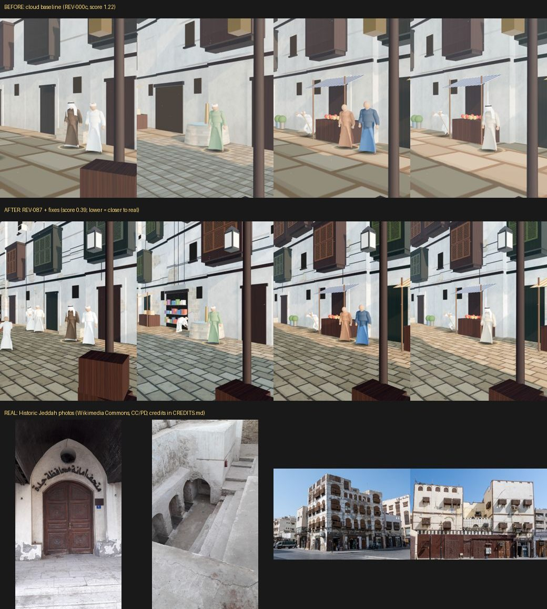

# Visual revisions REV-019 to REV-100: summary (19 Nov 2026)

**Score 1.22 → 0.39** (cloud judge; lower = closer to the real Historic Jeddah photos). Branch `wip/visual-rebuild`.
81 revisions run (the REV-092 slot was the full-lab checkpoint): 32 kept (including bug fixes and motion changes), the rest rejected or reversed. Every one is logged in [README.md](README.md).

## What made it look more real
- **A final grade after AgX:** photo-like black and white points, faint grain.
- **Rawasheen with real screens:** fine grille above, louvres below, a dark room behind.
- **Paving at real size** (about 0.4 m stones) with dark, dirt-filled joints and worn surfaces.
- **Dark doors and windows**, like real interiors.
- **Street life on the walls:** AC units with drain lines, cables, shutter boxes, shops with goods on shelves, a glass lantern.
- **Green and turquoise painted woodwork**, as in the photos.
- **A slightly wider lens** (66° on phones): more of the street, speakers still clear.
- **People** (from Edward's two videos):
  - five more men doing ordinary things down the lane
  - listeners turn toward whoever speaks
  - breathing and weight shifts
  - each man his own build
  - carriers hold their load
  - thobe skirts and ghutra capes move in a light breeze

## Checked
- **Full lab every 10 revisions:** Suite R 100%, all 100 play-throughs visible.
- **Draw calls:** at most 96 (phones ≤150), budget Android 55 (≤100). Final full lab: [LAB-REV-100.md](LAB-REV-100.md).
- **Hard rules unchanged:** no faces, all-male, modest dress, morning only, no music.

## Honest notes
- **Cloud vs Mac:** the cloud renders lighter than the Mac, so scores are not comparable with the Mac's 0.874.
- **Noise:** the judge varies by about ±0.01 between runs, so small gains were re-run.
- **Two gains reversed:** REV-090 and REV-095 only gained because the judge counted bluish shade as "sky".
  - Suggestion: make the judge ignore the ground half for sky. Not changed during the loop.
- **Motion isn't scored:** the judge sees only the opening still, so the movement changes were judged by eye on frame sequences. They need Edward's eye in the running game.
- **Kept by eye, not by score:** tall windows between the bays (REV-053) looked closer to the photos, but the judge disagreed, so they were left out. Worth a look.
- **Biggest remaining gaps:** fine detail (z −0.7), sky in frame (−0.7) and contrast (+0.6).
